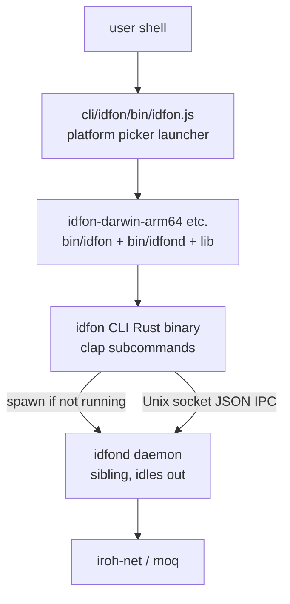

# CLI & npm Distribution Architecture

`cli/` is the npm distribution of the `idfon` CLI: a thin JS launcher plus
per-platform packages containing prebuilt Rust binaries. The Rust sources live in
`crates/`.

```text
crates/                        # Rust workspace
├── idfon-cli/                 # `idfon` binary: clap noun-verb subcommands
│                              #   (peer add, live stop, ...) → daemon methods
│                              #   auto-spawns idfond next to itself;
│                              #   daemon idles out when no clients (--keep-alive)
├── idfond/                    # the daemon: Unix-socket JSON IPC, iroh sessions
├── idfon-client/              # socket framing client (read_frame/write_frame)
├── idfon-protocol/            # shared request/response types
├── idfon-core/                # identity/keys/session core (ed25519 + iroh)
└── idfon-media/               # media pipeline

cli/                           # npm layout (pnpm workspace)
├── idfon/                     # `idfon` npm package
│   ├── package.json           # optionalDependencies → platform packages
│   └── bin/idfon.js           # launcher: picks idfon-<platform> by
│                              #   platform-arch, execs the binary; repo-layout
│                              #   fallback for uninstalled dev checkouts
└── idfon-<darwin-arm64|darwin-x64|linux-arm64|linux-x64>/
    └── bin/                   # idfon, idfond, libiroh_c_ffi.dylib/.so
                               #   (populated by scripts/build-cli.sh, gitignored)
```



Key facts:

- **CLI is a thin client**: `crates/idfon-cli` only parses args and maps them onto
  daemon methods; all networking lives in `idfond`. The CLI auto-starts `idfond`
  (located next to its own binary) which exits after an idle timeout when no
  clients remain.
- **One daemon, many clients**: the mac app, native-SDK app, and CLI all share the
  default `/tmp/idfon/idfond.sock` and can talk to the same daemon.
- **No win32**: idfond IPC is a Unix socket (`std::os::unix`); Windows needs a
  named-pipe transport first (noted in `idfon.js`).
- **Contact vCards**: `idfon contact export [--peer REF] [--out F]` wraps a
  contact ticket (this identity's `contact.ticket`, or a saved peer's primary
  pair) in a vCard 3.0 card twice: `X-IDFON-TICKET` (ticket token) and
  `URL:idfon://add/<base64url>` (the deep link that survives an AirDrop
  round-trip through the Contacts app, which strips unknown X- properties but
  keeps standard `URL` fields). `idfon contact import [FILE|-]` adds every
  idfon card in a .vcf via `peer.add`, reading either slot (foreign cards are
  skipped). Codec: `crates/idfon-protocol/src/vcf.rs`.
- **Publish flow**: `scripts/build-cli.sh` populates `cli/idfon-*/bin/`,
  `scripts/publish-cli.sh` publishes; CI workflow `cli.yml` must be run with
  `gh workflow run cli --ref cli-v<ver>` (tag pushes fire nothing — no tags
  trigger). Package names on the registry stay `idfon` / `idfon-*`; see
  [npm-distribution.md](npm-distribution.md).

## For agents

The CLI is judged by how easily an agent uses it from the skill alone
(`tools/cli-eval/`). The pieces that serve agents:

- **The skill ships in the binary**: `idfon skill` prints
  `skills/idfon/SKILL.md` as built into this version (`include_str!`), so an
  installed CLI never disagrees with its guide.
- **`idfon mcp server`** speaks MCP over stdio (`2026-07-28`, and the older
  `initialize` handshake). Tools are generated from the clap definitions, so
  every command is one (`peer add` → `peer_add`, flags → arguments) and the
  MCP surface cannot fall behind the CLI. A call runs the same binary and
  returns its output; `mcp …`, `shutdown`, `skill` and `--follow` are left out
  (they block or are the server itself). The skill is the server's
  instructions. Code: `crates/idfon-cli/src/mcp_server.rs`.
- **Errors name the next command**: daemon errors print a `hint:` line
  (`hint_for` in `main.rs`), and timeouts say how to keep waiting
  (`idfon card wait … --card ID`, `idfon inbox --from bob --new`).
- **`inbox --new`** shows messages since the last `inbox --new`; the mark is a
  cursor in `<idfon home>/cli/`, per daemon socket, identity and `--from`.
- **A stale daemon restarts itself**: when the daemon the CLI autostarted
  (`IDFON_AUTOSTARTED=1`) reports that its code changed on disk
  (`daemon.status` `build.stale`, after a rebuild or an upgrade), the next
  command shuts it down and starts a fresh one, unless another client is
  connected or a broadcast runs. The mac app's daemon and a daemon a script
  started are never touched.
- **`idfon ask`** puts an Allow/Deny card (`kind: "ask"`) on a contact's phone
  and exits 0 only on Allow; deny, error or no answer within `--timeout`
  (default 5m) is non-zero. Only that contact's answer to that card counts.
  The card is durable; if it isn't delivered within 3 s (the phone is asleep),
  the daemon rings the contact's doorbell (`peer.doorbell`, the existing "New
  message" push), and the woken iPhone shows the ask as a lock-screen
  notification whose Allow (after Face ID) and Deny answer without opening the
  app. On timeout, a card the phone never got is called off (operation
  cancel); one it got is replaced by an expired card, which removes the
  notification. The decider is `--to PEER` or the `ask.peer`
  setting, and must be another identity (typically the idfon app on your
  phone, added as a contact of the identity the agent uses).

`idfon ask` makes the phone the approval channel for any agent tool. For
example, a Claude Code hook that holds risky shell commands for a tap:

```sh
#!/bin/sh
# .claude/hooks/ask-on-phone.sh (PreToolUse, matcher "Bash")
cmd=$(jq -r '.tool_input.command')
case "$cmd" in
  *"git push"*|*"rm -rf"*) ;;
  *) exit 0 ;;
esac
idfon ask "Run: $cmd" --timeout 2m >/dev/null 2>&1 && exit 0
echo "Denied on the phone, or no answer: do not run it." >&2
exit 2
```

```json
{ "hooks": { "PreToolUse": [ { "matcher": "Bash",
  "hooks": [ { "type": "command", "command": ".claude/hooks/ask-on-phone.sh" } ] } ] } }
```

The agent cannot answer for you (the answer must come from the decider's
identity), but an agent with shell access can also edit the hook: this guards
against slips, not against a hostile agent.
